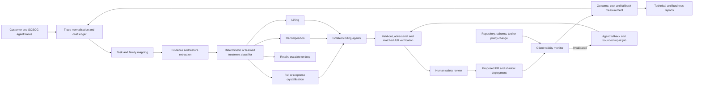

# SOSOG — Technical Brief for a CTO / Technical Co-founder Candidate

Status: working recruiting brief, 23 August 2026

## Executive summary

SOSOG is building an audit and optimisation system for AI workforces.

The core thesis is that production agents are frequently given more model
intelligence, autonomy and inference budget than every task requires. Some
tasks need a capable agent. Others recur with sufficiently stable tool-use
patterns that they can be handled by a cheap structured-intent parser plus
deterministic software. A third group can be decomposed into a deterministic
prefix and an agentic tail, or improved by supplying successful trace
exemplars. The correct intervention depends on evidence from repeated traces,
not intuition about the prompt.

The initial commercial product is therefore a productised AI implementation
and cost-optimisation service:

> Connect model spend to verified task outcomes, find repeatable and expensive
> workload segments, propose cheaper execution paths, and prove that quality is
> preserved before anything is promoted.

Today SOSOG is an internal tool verging on a product. It has a substantial
Retail proof, early transfer evidence from Airline and software-engineering
workloads, a deterministic routing prototype, and the first version of a
pipeline that converts traces into treatment decisions, bounded coding jobs,
technical reports and business reports. It is not yet an autonomous production
optimizer, a universally accurate predictor, or a self-serve SaaS product.

The next technical step is to make the investigation and implementation
process itself closed-loop. SOSOG will record its own coding-agent traces,
costs, test results and review outcomes, then crystallise repeatable parts of
its own workflow over time. The system becomes its own first customer.

## The problem

The normal response to expensive agents is to negotiate model prices, shorten
prompts or route requests to a cheaper model. Those techniques help, but they
leave a more fundamental question unanswered:

> Did this task need an open-ended model loop at all?

Agent observability products can show traces, spans, tokens and latency. An
operator still has to determine which behaviours are stable, what can safely
be replaced, how to generate that replacement, and whether it remains correct
across new inputs. SOSOG is aimed at that layer between observability and
implementation.

The proposed unit of analysis is a business task with:

- a request or trigger;
- a sequence of model, tool and state interactions;
- a measurable cost;
- and a trustworthy outcome such as a database state, test suite, escalation,
  correction or business-owned success label.

For each task family, the system asks:

1. Does the task recur with a stable successful action structure?
2. Can natural language be converted into a narrow intent schema cheaply and
   safely?
3. Can the complete workflow be crystallised into deterministic code?
4. If not, is there a safe read-only prefix that can be crystallised before an
   agentic tail?
5. If not, can successful exemplars or other assistance lift the agent's
   reliability?
6. Should the task remain fully agentic, change strategy, escalate early or be
   dropped?

## What has been demonstrated in Retail

Retail is the most complete proof. It uses the maintained tau2 Retail domain,
Claude Sonnet 4.6 through AWS Bedrock, and programmatic database-state
verification for a 74-task DB-checkable set. The evidence is benchmark evidence,
not yet customer-production evidence.

### 1. Repeated tasks form materially different stability classes

The single-run cached baseline passed 68/74 tasks, or 91.9%, at a total measured
benchmark cost of $11.03. A repeated N=10 corpus produced 740 valid runs with a
90.4% individual-run pass rate and cost $107.06, excluding the earlier dry run.

Under the strict initial promotion rule — at least 9/10 DB passes and exactly
one passing write-action skeleton — 54/74 tasks were classified as promotable
candidates. Those tasks represented $7.42, or 67.3%, of the measured single-run
baseline cost. This is a candidate-cost denominator, not a claim that 67.3% of
any customer's bill is automatically recoverable.

The repeated runs mattered. Some tasks that looked stable at small N later
failed or produced a second valid action skeleton. That is evidence for the
investigation methodology as much as for the optimisation thesis.

### 2. A deterministic procedure worked on new task instances

SOSOG did not merely replay successful tool calls containing fixed customer,
order and product IDs. It converted the successful traces into reusable return
and exchange procedures.

Given a structured request such as “identify this customer, return this product
and refund the original payment method,” the procedure used read-only tools to
find the relevant customer, order, item IDs and payment method. It then executed
the appropriate write operation.

We tested the procedures on held-out customers, orders and products that were
not used to create them. The resulting database states passed the programmatic
verifier with zero LLM calls at runtime.

This rules out simple hard-coded trace replay and demonstrates limited
generalisation within the selected Retail task families. It does not yet prove
that the procedures cover every valid return or exchange, interpret arbitrary
natural language, or transfer unchanged into another company. That is not the
intended product boundary: SOSOG's platform should generalise across clients,
while the transformations it generates are deliberately fitted to each
client's workflows, repository, policies and task distribution.

### 3. Cheap language parsing can sit in front of deterministic execution

A Haiku parser was tested on 18 messy natural-language return requests. Ten
requests parsed and executed cleanly, six correctly deferred, and two initially
caused wrong writes. The two unsafe cases were important: a cheap parser cannot
be treated as a trusted router or sent directly into a mutating executor.

A deterministic schema and state-consistency gate subsequently converted both
known wrong writes into deferrals. A refined gate recovered the two harmless
over-deferrals while preserving:

- 10/18 clean deterministic completions;
- 8/18 safe deferrals to an agent;
- 0 wrong writes on the tested set;
- and 3/3 adversarial cases deferred before any write.

For the ten clean requests, measured Haiku parsing plus deterministic execution
cost $0.0151 versus an estimated $0.9407 Sonnet agent-only comparison, a 98.4%
reduction on that clean subset. With fallback included for all 18 requests, the
tiered path was estimated to reduce agent-only cost by 57.5%. The comparison is
partly estimated because Sonnet was not rerun on every rewritten request.

The architectural conclusion is stronger than the headline percentage:

> The cheap model belongs before strict schema and consistency gates. It is an
> untrusted intent parser, not the safety authority.

### 4. A new executor family can be generated substantially from traces

The automation probe targeted a cancel-order family that had not previously
been hand-built. From passing traces and tool contracts, SOSOG derived a
parameterized executor and generated the schema and safety-gate specification.
It passed two held-out tasks in both hand-fed and self-resolved modes, with zero
model calls, and deferred 3/3 dangerous adversarial cases with zero writes.

The honest automation assessment is approximately 80%, not 100%. The executor
was fully derived; the selector boundary and safety invariant still required
human review. This is exactly why the near-term offering looks like
implementation consultancy supported by software rather than autonomous code
promotion.

### 5. Partial crystallisation works, but only for selected tasks

For tasks that could not be fully crystallised, SOSOG tested a deterministic
read-only prefix followed by a Sonnet tail. Correctness and cost both improved
on some tasks:

- task 78: 10/10 baseline and 10/10 decomposed;
- task 97: 20/20 and 20/20;
- task 30: 20/20 and 20/20.

Those three tasks saved $1.87 across their measured matched samples. However,
task 100 fell from 20/20 to 14/20 after decomposition even though its prefix was
deterministic, read-only and correctly reproduced. Two other tasks preserved
correctness but cost more.

This negative result is strategically valuable. A stable prefix is not enough:
the handoff can remove reasoning context that the volatile tail needs. The
system needs task-dependent promotion and independent matched evaluation, not a
blanket rule that deterministic reads always help.

### 6. Successful traces can lift an inconsistent agent

For Retail task 49, adding two compact successful trace exemplars improved the
agent from 6/20 baseline passes to 20/20 lifted passes, with 14 newly passing
paired trials and zero regressions. Measured cached agent cost also fell by
$0.62 across the 20 lifted runs because the agent needed fewer calls, despite
receiving more prompt context.

Only one of eight lifting candidates has been validated at this depth. The
result proves that lifting is a real treatment worth testing, not that it will
generalise automatically.

## What is happening now

The work is moving from baseline collection into automated classification,
transformation and verification.

### Airline transfer

The latest Airline corpus contains 500 attempted rows. SOSOG's current pipeline
excluded 165 incomplete or infrastructure rows and classified the 335 completed
runs across all 50 tasks. Those completed runs cost $48.51 in the recorded
benchmark ledger.

The first automated treatment plan produced:

| Treatment | Tasks | Meaning |
| --- | ---: | --- |
| Full crystallisation | 12 | Stable successful mutating path suitable for executor-and-gate generation |
| Response crystallisation | 8 | Stable successful response/read path with no writes |
| Decomposition | 4 | Common safe read prefix with a volatile write tail |
| Lifting | 2 | Mid-band genuine action inconsistency suitable for matched exemplar tests |
| Retain/review | 18 | Evidence does not justify an automatic intervention |
| Drop/early-exit study | 6 | Pass rate at or below the current 20% boundary |

This is promising transfer evidence because the rules identify actionable
lanes in a second transactional domain. It is not yet proof that the generated
Airline transformations pass held-out tests. Three bounded full-crystallisation
coding jobs have been emitted as the next implementation experiments.

### Prediction and routing

The rule-based prediction engine is deterministic and has zero inference cost.
On the frozen 21-task Retail held-out split it matched 20/21 route labels, or
95.2%, with one miss and $0.1536 of held-out regret. That figure is accuracy
against Retail-derived labels, not evidence of prediction on unseen customer
workloads. The upstream trace categorizer was only 50% accurate on its small
Retail human audit, so label quality remains a material limitation.

The purpose of v0 is to establish the contract — trace features in, treatment
and confidence out, cost-and-safety regret measured — while collecting the data
needed for a learned or hybrid predictor later.

### Cross-vertical investigation

Airline strengthens the structured support/operations thesis. SWE-bench
Verified adds a different signal: in the latest audited partial corpus,
software-engineering task outcomes were highly recurrent and failed outcomes
were materially more expensive than successful ones. Tests provide a strong
outcome verifier, making coding agents attractive for failure prediction and
adaptive-effort routing even where deterministic compilation is unrealistic.

AppWorld evidence remains too small to support a commercial conclusion.
WebArena completed its harness preparation and golden replay, but paid browser
inference remains intentionally paused. The product should not claim universal
cross-vertical transfer from these results.

### Automation pipeline

The current implementation can:

- ingest local or S3 JSONL traces;
- exclude incomplete and infrastructure-failed rows;
- group repeated runs by task;
- classify full crystallisation, response crystallisation, decomposition,
  lifting, retain and drop lanes;
- attach the correct runtime design and parser placement;
- emit bounded coding-agent specifications that cannot authorize merge or
  deployment;
- and generate evidence-based technical and commercial Markdown reports.

Coding-worker infrastructure is being prepared for isolated Git worktrees,
bounded concurrency and immutable JSONL event logs. It should be described as
under implementation until it is deployed, authenticated and has completed its
first independently verified code-generation job.

## Proposed system architecture

The design separates evidence collection, treatment selection, change
generation and promotion authority.



### Data plane

The data plane captures requests, model calls, tool calls, state transitions,
tokens, model/provider, latency, retries, cost, outputs and outcome signals. It
normalises existing customer tracing rather than requiring SOSOG to replace the
customer's observability stack.

Sensitive inputs, tool results and customer code require tenant isolation,
redaction, encryption, access controls, retention policies and an option to run
inside the customer's environment. Security architecture is part of the
product, not a later compliance wrapper.

### Task and family mapper

Individual traces must be mapped to durable business tasks and related task
families. Code structure alone is insufficient: the mapper needs runtime
behaviour, tool semantics, outcomes and business labels. It should combine
deterministic identifiers where available with trace-derived clustering and
human correction.

### Treatment classifier

The classifier does not generate code. It converts repeated-run evidence into
an auditable recommendation:

- `FULL_CRYSTALLIZE`;
- `RESPONSE_CRYSTALLIZE`;
- `DECOMPOSE`;
- `LIFT`;
- `RETAIN`;
- or `DROP`.

The initial classifier remains conservative and deterministic. A learned model
should replace or augment it only after SOSOG has enough cross-customer labels
linking trace characteristics to verified intervention outcomes.

### Execution lanes and parser placement

For full crystallisation, the intended runtime is:

```text
raw request
  -> cheap structured-intent parser
  -> schema gate
  -> state and consistency gate
  -> deterministic executor
  -> programmatic verifier
  -> full-agent fallback on ambiguity or gate deferral
```

For response crystallisation, a policy-and-state gate sits before a
deterministic response template. For decomposition, the system runs a proven
read-only prefix, validates the handoff and then invokes a full agent for the
volatile tail. The cheap parser does not sit inside that volatile tail. For
lifting, the initial path remains a full agent with selected exemplars and a
matched A/B evaluation; a cheap parser is added only if later evidence shows
the lifted task has become crystallisable.

The parser can initially use a small model such as Haiku, but the architecture
is model-agnostic. Its output is untrusted until deterministic gates pass.

### Change generation and independent verification

Coding agents receive a bounded task, exact trace evidence, relevant tool
contracts and a required verifier. Each works in an isolated worktree and can
propose code and tests. It cannot merge, push, deploy, modify production
credentials or decide that its own transformation is correct.

Promotion requires independent evidence appropriate to the treatment:

- held-out tasks or instances not used to derive the transformation;
- adversarial ambiguity and state-conflict cases;
- no writes on deferral;
- matched seeds or traffic for agentic comparisons;
- preserved or improved outcome quality;
- lower measured cost per accepted outcome;
- and human review of the safety boundary.

### Client-specific transformations and continuous revalidation

The platform should generalise; its generated transformations should
specialise. A deterministic return workflow does not need to work for every
company or domain. It needs to work robustly across the valid requests, states
and edge cases inside the customer deployment for which it was generated.

That specialisation is intentional rather than harmful overfitting when:

- customer, order, item and other instance identifiers are resolved at runtime
  rather than memorised;
- the transformation is tested on held-out and adversarial inputs;
- its assumptions and dependencies are explicit;
- unsupported or ambiguous requests fall back safely;
- and it is revalidated when those assumptions change.

Each client should therefore have a logical monitoring worker. This need not be
an LLM process continuously rereading the whole repository. It should be an
event-driven control-plane function triggered by relevant code, schema, tool,
policy and production-outcome changes, with scheduled audits as a backstop.

Every promoted transformation carries a versioned validity certificate:

- repository commit or deployed application version;
- dependent files, services, schemas and tool contracts;
- applicable policy version;
- generation traces and treatment decision;
- held-out and adversarial test evidence;
- required state and output invariants;
- fallback route and review boundary;
- and the time and result of its last successful revalidation.

The revalidation lifecycle is:

```text
relevant repository, schema, tool or policy change
  -> identify affected transformations
  -> run contract checks, trace replay and held-out tests
  -> renew the validity certificate if all checks pass
  -> otherwise quarantine the deterministic path
  -> route affected traffic to the full agent or escalation path
  -> open a bounded repair job
  -> independently verify and review the repair
  -> restore the deterministic path only after approval
```

The worker also monitors input, outcome and economic drift. A transformation
can remain technically executable while customer requests move outside its
validated distribution, correction or fallback rates rise, or the savings no
longer justify maintenance.

Initially, “self-healing” means automatic detection, quarantine, safe fallback
and a proposed repair. It does not mean that a coding agent silently rewrites
and deploys production workflows or approves its own work.

### Economic ledger and reporting

The business metric is not raw token reduction. It is cost per validated
outcome, including model usage, infrastructure, retries, fallback and human
review. Reports must distinguish observed benchmark or production cost from
estimated savings and must separate cash savings from credits or committed
spend.

A customer-facing report should explain:

- where AI spend is concentrated;
- which task families fail, retry or escalate;
- which interventions were tested;
- quality and safety outcomes;
- measured shadow savings;
- proposed code changes;
- and the evidence still required before promotion.

## The closed-loop system

SOSOG should dogfood the same framework on its own investigation and
implementation agents.

Every internal task should log:

- job, prompt, model and configuration versions;
- classification evidence and selected treatment;
- model and tool events;
- token usage and cost when exposed by the runtime;
- duration, retries and failures;
- files changed and tests run;
- reviewer decision;
- merge or rejection outcome;
- and subsequent shadow or benchmark performance.

The internal workflow can then be decomposed into trace ingestion,
classification, evidence summarisation, prompt creation, script generation,
test generation, review and report generation. Stable stages are crystallised;
partially stable stages are decomposed; volatile coding stages remain agentic;
and successful examples can lift weak stages.

The optimisation objective is:

> Total model, infrastructure and human-review cost per accepted, robust
> transformation — compared with the verified lifetime savings that
> transformation creates.

This produces the dataset that may become SOSOG's defensible advantage:

```text
trace characteristics
  -> selected intervention
  -> generated implementation
  -> held-out result
  -> reviewer decision
  -> production quality and cost outcome
```

The loop must not mark its own homework. A generated change cannot alter the
frozen evaluator used to approve it; the coding agent cannot approve or deploy
its own work; held-out sets and promotion thresholds are versioned; and failed
attempts remain in the evidence ledger.

## Product and commercial roadmap

### Phase 1 — Internal consultancy engine

Use the system to make AI implementation and cost audits faster and more
repeatable. Standardise trace ingestion, task mapping, economics, treatment
classification, code-change proposals and reports. Continue validating the
full/decompose/lift lanes on Retail and Airline.

Success means that SOSOG can repeat the audit internally with lower cost and
less manual work while preserving evidence quality.

### Phase 2 — Productised design-partner audit

Work with one or a small number of AI-native design partners. Start read-only:
ingest anonymised or in-environment traces, connect spend to verified outcomes,
and produce a ranked intervention ledger. Select one narrow, high-volume task
family for a shadow transformation.

The ideal first customer has repeated structured tasks, direct inference COGS,
existing telemetry, a reliable success signal and meaningful failed/retried
volume. Support and operations platforms, voice/BPO systems, transactional
vertical SaaS and coding-agent vendors are plausible initial targets.

Success is not a polished dashboard. It is one customer for whom SOSOG finds a
costly predictable segment and verifies a quality-preserving economic
improvement.

### Phase 3 — Continuous audit product

Turn one-off ingestion into a persistent connection. Monitor task mix, cost per
outcome, failure concentration, drift and fallback rates. Maintain the
dependency map and validity certificate for every customer transformation.
Relevant repository, schema, tool or policy changes trigger revalidation;
invalidated paths are quarantined and fall back safely. Continuously surface
reviewable optimisation and repair opportunities while maintaining an audit
trail of accepted and rejected changes.

At this stage, the customer buys an ongoing control and accounting layer for
its AI workforce, while implementation may still include forward-deployed
engineering.

### Phase 4 — Controlled closed-loop optimisation

Automate safe portions of change generation, evaluation and proposed PRs. Keep
deployment and high-risk business decisions behind customer-configured review
boundaries. Monitoring workers can automatically detect breakage and initiate
bounded repair jobs, but generated repairs still require independent evidence
before promotion. Build reusable family templates and integrations so the
marginal engineering effort falls with each deployment.

### Phase 5 — Predictive intelligence allocation

Use the accumulated cross-customer outcome dataset to predict the minimum
execution tier a new or changing task requires before paying for a full
investigation. The predictor may select deterministic execution, a small
parser, a decomposed workflow, a cheaper or stronger agent, exemplar lifting,
early escalation or a full agent loop.

This is the larger product opportunity, but it must be earned from intervention
outcomes rather than trained on benchmark route labels alone.

## What is exciting

Several pieces now fit together in a way that is more interesting than generic
token optimisation:

1. **The system has replaced full model loops on selected verified workflows.**
   These were real tool executions checked against database end state, not
   regex approximations of an answer.
2. **The natural-language boundary has been located empirically.** Cheap
   parsing worked, failed in concrete ways, and became safe on the tested set
   only when placed behind deterministic gates and fallback.
3. **Transformation generation is partially automatable.** A new cancel-family
   executor was derived from traces and generalized to held-out tasks, with
   human review concentrated at the safety invariant rather than every line of
   code.
4. **There is evidence for multiple treatments, not one optimisation trick.**
   Full crystallisation, decomposition and exemplar lifting each worked in
   selected cases; the failures show why treatment prediction is valuable.
5. **The economics are outcome-linked.** Airline and SWE evidence indicates
   that failed agent executions can be materially more expensive than
   successful ones. Avoiding or changing expensive failure paths may matter as
   much as compiling stable successes.
6. **The product can improve by using itself.** Internal agent traces provide a
   high-frequency, permissioned dataset for reducing the cost and manual effort
   of delivering the next customer audit.
7. **Consultancy and product development reinforce each other.** Early
   engagements create revenue and the trace-to-intervention-to-outcome data
   required for a credible prediction engine.

The potential moat is not the tracing layer or a static set of scripts. It is a
growing, audited dataset showing which trace patterns justify which
interventions, how those interventions were implemented, and whether they
actually preserved quality and saved money.

## What is not yet proven

Technical credibility depends on keeping these boundaries explicit:

- no universal customer savings percentage;
- no prediction accuracy claim on unseen customer task families;
- no proof that every stable benchmark task can be safely crystallised;
- no fully automated safety-gate generation;
- no production-grade autonomous promotion or rollback system;
- no evidence yet that the approach transfers cleanly to browser agents;
- no assurance that savings remain material after customer credits, discounts,
  engineering cost and fallback;
- and no proof yet that integration effort declines quickly enough to avoid a
  permanent bespoke-consultancy model.

The decisive next experiment is a design partner, not another large benchmark:
can SOSOG ingest real traces, identify one expensive and predictable task
segment, shadow-test a safer or cheaper execution path, and repeat the process
with less bespoke work on the next customer?

## Why a CTO / technical co-founder now

The technical work is moving from research scripts into a security-sensitive
system that generates and evaluates changes to customer AI workflows. The
company needs an owner who can turn strong experiments into a coherent product
without weakening the evidence standard.

The CTO would own the hardest connected problems:

- the canonical trace, task, outcome and cost data model;
- secure in-environment and hosted deployment boundaries;
- task-family discovery and human-correctable mapping;
- transformation and gate generation;
- independent evaluation, shadowing, rollback and auditability;
- coding-agent orchestration and self-observability;
- the transition from deterministic rules to a calibrated predictor;
- and the architecture that prevents forward-deployed work from becoming
  permanently bespoke.

The immediate goal is not to build a large platform in isolation. It is to
create a narrow end-to-end loop that survives contact with one real customer's
data and economics, then use every engagement to make the next deployment more
automated.

## Suggested first 90 days

1. Harden the trace and outcome contracts, the treatment classifier and the
   immutable economics ledger.
2. Complete the first Airline code-generation and independent verification
   jobs, including adversarial deferral tests and matched cost measurement.
3. Deploy the isolated coding-worker runner with complete self-tracing, but no
   autonomous merge or deployment authority.
4. Package a read-only design-partner audit with a standard data request,
   security boundary, technical report and executive savings report.
5. Secure one design partner and select one high-volume task family for shadow
   intervention.
6. Measure both delivery economics and customer economics: hours and inference
   cost per accepted transformation, quality, fallback rate and expected
   lifetime savings.

## Repository evidence

The main supporting artifacts are:

- `docs/M2.md` and `docs/M3.md` — Retail baseline and repeated-run corpus;
- `docs/M5.md` through `docs/M8.md` — deterministic generalisation, language
  parsing, safety gates and automation probe;
- `docs/M10.md`, `docs/M11.md` and `docs/M12.md` — assistance, decomposition
  and lifting experiments;
- `docs/M17.md` and `predictor/` — rule-based routing and regret harness;
- `promotion_engine/` — current treatment classifier, workflow design and
  report generation;
- `metrics/m18_airline_promotion/` — first Airline promotion plan, coding jobs
  and reports;
- and `docs/vertical_investigation_progress_2026-08-22.md` — cross-vertical
  progress, costs, limitations and commercial implications.
